layout: true
name: fullheader
background-image: url(../apachecon/img/neonbrand-258972-unsplash-sm.jpg)
background-size: cover

---
layout: true
name: contributions
background-image: url(../apachecon/img/rawpixel-600782-unsplash-sm.jpg)
background-size: cover

---
layout: true
name: thanks
background-image: url(../client/img/stuart-guest-smith-150560-169.jpg)
background-size: cover

---
layout: true
name: fosdem
background-image: url(../fossbackstage/img/KaraSowles-FOSDEM2024-Slide6.png)
background-size: cover

---
layout: true
name: logorb
class: left
background-image: url(img/ComCodeLogo.png)
background-repeat: no-repeat
background-position: bottom .8rem right 5rem
background-size: 10%

---
template: fullheader
# *Coming up next*

# FOSS Funding: How Much?
# Shane Curcuru 

---
template: fullheader
name: start
# FOSS Funding: How Much?
## Who funds FOSS foundations, and where the money goes

### @ShaneCurcuru [FOSSSustainability.com/ComCode](https://fosssustainability.com/comcode)

---
template: logorb
# Resources

Resources and data are open source:

## [FOSSSustainability.com/ComCode](https://fosssustainability.com/comcode)
## [FOSSFoundation.info](https://fossfoundation.info/)
## [FOSS IRS 990 parser](https://github.com/Punderthings/foss990parser) *NEW*

*Actively seeking submissions!*

.bottomnote[license: Apache-2.0]

???
Please follow along at fosssustainability.com/comcode for links to slides
and all the data and code associated with this project!

---
template: logorb
name: topics
# Topics

- Aspects of Sustainability
- Foundation Sponsorships
- Financial Data (US)
- **NEW:** Sponsors over time
- **NEW:** Where the money goes

???
Topics:
- Fiscal sustainability - all the different ways projects might get funded
- Modeling sponsorship models of major foundations
- Comparative US Foundation revenue and asset data
- NEW this year: IRS e-file data down to expenses, staff, contractors, and grants - through fiscal year 2025

**SPACEBAR**

--
- *Finding better **questions** to ask*

???
I hope to leave everyone with enough information and ideas, so that you can start asking better questions when you're working on sustainability.
Note: this is US centric data; would love help collating non-US nonprofit data.

---
template: fullheader
name: aspects
# Aspects of Sustainability

???
Why is open source funding so hard?  Because there are so many different aspects or ways that different people, organizations, and ecosystems think about funding and sustainable work.

---
template: logorb
# Aspects of Sustainability

.left-column-equal[
**Who**

- Users
- Contributors
- Maintainers
- PMC / TSC
- Foundation Boards
]
.right-column-equal[
**What**
- Software Companies
- Non-Software Companies
- Educational Institutions
- Governments
- Standards Bodies
]

.bottomnote[https://fosssustainability.com/aspects/]

???
Listening to financial sustainability conversations, I'm struck by how siloed they are.  Each participant is coming in with their own needs and their own vocabulary, and it's often hard to find efficient ways to translate one aspect's needs to the vocabulary or taxonomy some other aspect needs.  Note that we're focusing on financial sustainability in particular.

---
template: logorb
# Aspects of Sustainability

.left-column-equal[
**Who**

- Users
- Contributors
- **[Maintainers](https://fosssustainability.com/aspects/maintainer?s=ss)**
- PMC / TSC
- Foundation Boards
]
.right-column-equal[
**What**
- **[Software Companies](https://fosssustainability.com/aspects/software-company?s=ss)**
- Non-Software Companies
- Educational Institutions
- Governments
- Standards Bodies
]

.bottomnote[https://fosssustainability.com/aspects/]

???
STORY: Maintainers keep seeing companies with OSPOs or FOSS Funds talking about funding open source projects - but few see the actual money, and certainly not enough to make a living.
How do we explain the vast value companies get from the entire dependency chain (not just their direct dependencies)?  How do we help maintainers look for funding?

---
template: logorb
# Aspects of Sustainability

.left-column-equal[
**Who**

- Users
- **[Contributors](https://fosssustainability.com/aspects/contributor?s=ss)**
- Maintainers
- PMC / TSC
- Foundation Boards
]
.right-column-equal[
**What**
- Software Companies
- Non-Software Companies
- **[Educational Institutions](https://fosssustainability.com/aspects/education?s=ss)**
- Governments
- Standards Bodies
]

.bottomnote[https://fosssustainability.com/aspects/]

???
Another example: while university curricula may cover technical mechanics of open source development, where are the classes helping new contributors understand how to seek funding or otherwise market their project as a whole, not just as a codebase?

---
template: logorb
# Aspects of Sustainability

.left-column-equal[
**Who**

- Users
- Contributors
- Maintainers
- PMC / TSC
- **Foundation Boards**
]
.right-column-equal[
**What**
- Software Companies
- Non-Software Companies
- Educational Institutions
- **Governments**
- **Standards Bodies**
]

.bottomnote[https://fosssustainability.com/aspects/]

???
And currently, with the CRA and PLD coming in Europe, it's likely that any major open source project will likely face new legal hurdles in Europe.  How do we connect the Foundations that manage and provide support to many of these major projects with the Standards Bodies making up the new rules?  Or the Governments, that are forcing complexity on FOSS projects who don't have the resources to handle that complexity?

---
template: fullheader
# Aspects of Sustainability

> How do we translate between these groups?

.bottomnote[https://fosssustainability.com/aspects/]

???
Even with the best of intentions, many of the stories we tell don't have the right impacts on different groups.  Even as governmental policy makers are studying and planning for how to help the FOSS ecosystem, the needs of each group are often poorly understood, because they're not getting translated into policy speak, or classroom theory.

---
template: fosdem

???
Never mind the different interest groups; let's just ask: how can you actually transfer funds?  There are many, many different ways, making this a complex topic (so: ask better questions!). 

This is an excellent holistic overview of how funding typically gets to open source contributors, foundations, and more.  From [Kara Deloss' excellent talk at FOSDEM 2024](https://fosdem.org/2024/schedule/event/fosdem-2024-2751-the-state-of-funding-free-open-source-software/).

---
template: fullheader
name: finance
# Who Funds FOSS Foundations?

???
OK, Shane, you've shown us all the complexity, how about answering the question?

---
template: fullheader
name: finance
# Who Funds FOSS Foundations?

## *Corporate Sponsors*

???
The largest income source for common FOSS Foundations are corporate sponsorships.

But: sponsorships are only part of the equation.  Depending on the type of foundation and the ecosystem they're in, the amount of sponsorships vs. individual donations vs. "program income" (event tickets, services fees, etc.) varies widely.

---
template: fullheader
name: sponsorship
# Modeling Sponsorship Programs

> Modeling *actual* foundation programs

???
In researching how foundations are funded, I wanted to see how much income was directly from official sponsorship models, and how those sponsorship models were structured and marketed.  What kinds of benefits do sponsors get, and how much does it cost?

So I built a model and analyzed 30+ foundations or sub-foundations to see the data.  More to come!

---
template: logorb
# Sponsorship Program Criteria

- Only publicly posted programs
- Not tracking event sponsorships
- Level amounts are approximate
- Tracking 39 foundations so far
- NEW: Historical data for some foundations

.bottomnote[https://fossfoundation.info/sponsorships]

???
I'm focusing on quantifying how traditional foundation corporate sponsorships are modeled.  All data is drawn from publicly posted sponsorship programs in the past year or so.  This is not including event sponsorships, because those have a different typical structure, and aren't expected to be continuing.

**IMPORTANT:** Numbers are approximate! A number of programs offer sliding scales by numbers of employees or revenue; we track the top end of each level's cost.  Also, we don't know the actual details of sponsorships; some may pay more or less depending on discounts or other factors.

Model schema explainer: https://fossfoundation.info/sponsorships#sponsorship-model-structure

---
template: logorb
# Sponsorship Program Schema

- Program level map: *first, second,..., community, etc.*
- Track funding **amount** per level
- Model the **benefits** for levels
  - *Governance* /or/ *Advisory* roles
  - Services, Events discounts
  - Marketing partnerships
- Scrape websites or landscape.yml for data

.bottomnote[https://github.com/Punderthings/fossfoundation/blob/main/_data/sponsorships-schema.json]

???
Most organizations include scraping definitions to automatically parse listings of sponsorship pages; some are manually drawn maps as of a specific date.  Future ideas include using the wayback machine to see historical sponsorship trends, both of foundations, and of sponsors.

Model schema explainer: https://fossfoundation.info/sponsorships#sponsorship-model-structure

---
template: logorb
# Sponsorship Program Dataset

.left-column-equal-vsm[
- Adélie Linux
- Arch Linux
- ArduPilot
- Apache Software Foundation
- Academy Software Foundation
- CD Foundation
- Cloud Native Computing Foundation
- Debian
- Drupal
- FINOS Foundation
- FreeBSD
- Free Software Foundation Europe
- Gentoo
- Gnome
- GraphQL Foundation
- Haskell
- Hyperledger
- JS Foundation
]
.right-column-equal-vsm[
- Linux Foundation
- LF AI Foundation
- LF Energy Foundation
- LLVM Foundation
- NumFOCUS
- Open Mainframe Foundation
- Open SSF Foundation
- Open Stack Foundation
- OSGEO
- Open Source Initiative
- OWASP
- Plone
- PostgreSQL
- Python
- Rails Foundation
- Raspberry Pi NA
- Software Freedom Conservancy
- Software in the Public Interest
]

.bottomnote[https://fossfoundation.info/sponsorships]

???
**IMPORTANT:** this is only a subset of foundations, mostly depending on which foundations fit the criteria and were easiest to write scrapers for - or had a small enough sponsor list I could manually hardcode it.  This does not represent the whole ecosystem.

---
template: logorb
name: howweknow
# How We Know: Sponsor History

- **1,120** dated sponsor lists for 38 sponsor programs
  - **610** from landscape git histories (LF, CNCF, OpenSSF...)
  - **414** from Internet Archive captures (Apache since Jan 2016)
  - **72** OpenStreetMap wiki revisions; **11** FSFE yearly pages
- Every list keeps a link to its source capture or commit
- Each sponsor becomes a span: *level, first seen, last seen*

.bottomnote[NEW: history/sponsorships/ at github.com/Punderthings/fossfoundation]

???
This is the big data change since last year: instead of a single snapshot, fossfoundation.info now records when each sponsor appeared, changed level, and left.
26 programs have 9 or more recorded lists; the rest have one or two so far. Short gaps of a month or less are bridged.
Caveats: Internet Archive captures can miss short-lived changes; some sponsor pages were restructured (OWASP reset its list in Nov 2023, OpenStack and Eclipse changed page scope), and I exclude those from the trend numbers.
PRs welcome: more historical sources, especially for European foundations.
---
template: logorb
# Sponsorships - Apache

.left-column-equal[
**Funding Sponsors**
- First: **8** *Platinum*
- Second: **6** *Gold*
- Third: **8** *Silver*
- Fourth: **11** *Bronze*
]
.right-column-equal[
**In-Kind Sponsors**
- First: **11**
- Second: **5**
- Third: **3**
- Fourth: **9**
]

.bottomnote[book values (USD): Cash ~1.6M, In-Kind: ~1.75M · Oct 2026]

???
These calculations are done by multiplying the number of listed sponsors at each level, times the "price" of that sponsorship level in the prospectus.

We can see a good mix of sponsor levels; in-kind (targeted) sponsorship is nearly as large as cash.
Data note: counts are from the Oct 1 2026 Internet Archive capture of apache.org/foundation/sponsors. A year ago (Sept 2025) it was 10/9/5/9 cash: the drop at Platinum and Gold is mostly companies moving down a level (Yahoo to Silver, IBM to Silver) plus Geico leaving.
Book value at list prices: 8x125K + 6x50K + 8x25K + 11x6K = ~1.57M cash; in-kind ~1.75M. Cash is now below in-kind.

---
template: logorb
# Sponsorships - Apache

.left-column-equal-sm[
**First Level Cash Sponsors**
- Amazon + *In-Kind*
- Apple
- Google
- Huawei
- Meta
- Microsoft + *In-Kind*
- Snowflake
- Visa
]
.right-column-equal-sm[
**First Level In-Kind Sponsors**
- Cloudbees
- DLA Piper
- Fastly
- GitHub
- Gradle
- JetBrains
- JFrog
- Sonatype
- Yahoo
]

???
Changes since last year: Snowflake joined at Platinum (Jul 2025); Geico left (Feb 2026); Yahoo moved from Platinum to Silver cash (Apr 2026) but stays a Platinum in-kind sponsor. Amazon and Microsoft are also in the in-kind first level (not repeated in the right column).
Here's **who** sponsors the ASF at the highest level.  I have data files on who sponsors all the foundations tracked in the model online at FOSSFoundation.info, showing which companies like sponsoring only at the top level, for example.

---
template: logorb
name: asfhistory
# Apache Sponsors Over Time

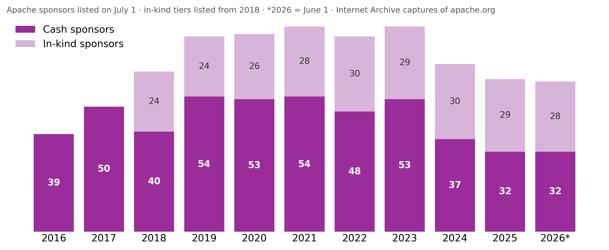

.bottomnote[Cash sponsors: **53** (2023) to **32** (2026); in-kind steady at ~29]

???
Every bar is the sponsor list on apache.org on July 1 of that year, from Internet Archive captures (2026 is June 1). In-kind sponsors were first listed separately in 2018, which is also why cash drops that year: some sponsors moved to the in-kind list.
Between July 2023 and July 2024, 22 sponsors left. Estimated sponsorship income (cash + in-kind, at list prices): 4.03M (2023) to 3.34M (2026).
The cash drop is real money: the ASF 990 shows contributions falling from 2.38M (FY2024) to 2.08M (FY2025).
NOTE TO SELF, do not show without checking first: 17 Bronze sponsors dropped off in 2023-24, and 14 of them vanished in one step between the Feb 6 and Mar 26 2024 captures (Bronze went from 27 to 13), which looks like a page cleanup or policy change rather than 14 separate decisions. Check with ASF Fundraising before mentioning; don't name companies on screen.
Dropped Feb-Mar 2024: aboutpaf.com, bestecasinobonussen.nl, cafe24.com, craftercms.org, goread.io, hotwaxsystems.com, leovegas.com, miro-kredit.ch, openlogic.com, praca.pl, purevpn.com, tii.ae, twitter.com, writersperhour.com. Later in 2024: dimealley.com, dollarhand.com (Sep), cerner.com (Dec).

---
template: logorb
name: loyalcore
# The Loyal Core

**21** Apache sponsors listed since 2018 or earlier are still here

.left-column-equal[
**Cash**
- Google, Meta *(Platinum)*
- Bloomberg, Union Investment *(Gold)*
- Capital One, Red Hat *(Silver)*
- RX-M *(Bronze)*
]
.right-column-equal[
**In-Kind**
- DLA Piper, Microsoft, Sonatype
- Atlassian, Datadog, phoenixNAP
- Google, PagerDuty, SURF, Virtru...
]

.bottomnote[Thank you! Long-term sponsors are the foundation of a stable budget]

???
A thank-you slide, and the tenure point: most sponsors that leave do so within two years, but there is a core that has stayed for 8+ years.
"Since 2018 or earlier" because in-kind tiers were first listed separately in 2018; cash sponsors are tracked from January 2016.
Full in-kind list: DLA Piper, Microsoft, Sonatype (first level); Atlassian, Datadog, phoenixNAP (second); Google, Hopsie, No-IP, PagerDuty, PCCC, Sonic, SURF, Virtru (fourth).
---
template: logorb
# Does the Model Match Reality?

- Estimate: Sponsor list × model level price
- Accounting: IRS 990 contributions + program revenue

| Foundation | Model (cash) | 990 (latest) | Ratio |
|---|---|---|---|
| **Apache** (FY Apr 2025) | 2.05M | 2.08M | **0.99** |
| OpenInfra (2024) | 4.95M | 4.26M | 1.16 |
| Python (2024) | 1.93M | 4.03M | 0.48 |
| NumFOCUS (2024) | 0.94M | 8.13M | 0.12 |
| Linux Foundation (2024) | 35.1M | 213M | 0.16 |

.bottomnote[Sponsor lists 2024-25; 990s via FOSS990Parser. Indicative only]

???
For a sponsor-funded charity like the ASF, simply multiplying listed sponsors by the prospectus price predicts the real 990 number within 1%.
Where the ratio is far below 1, most money comes from somewhere else: fiscally sponsored project donations (NumFOCUS), PyCon (PSF), or events and training (LF).
Above 1: list prices above actual, or timing differences between sponsor list dates and fiscal years.

---
template: logorb
# Who Sponsors Everyone?

.left-column-equal[
**Foundations sponsored**
- Google: **18**
- Microsoft: **16**
- Red Hat: **14**
- Amazon: **12**
- Bloomberg: **10**
- Capital One: **9**
]
.right-column-equal[
**ASF top sponsors elsewhere**
- Microsoft: *LF, FINOS, FreeBSD, GraphQL...*
- Bloomberg: *CNCF, NumFOCUS, OSI, OWASP...*
- IBM: *CNCF, Hyperledger, OpenSSF...*
- Apple: *CD, CNCF, OpenSSF*
]

.bottomnote[37 foundations, ~2,900 sponsor companies; 181 sponsor 3+ foundations]

???
This is the "surprise" I promised in earlier versions of this talk: a small set of companies show up as sponsors across a large share of the foundations we track.
Counts are by sponsor company domain, with subdomains merged (aws.amazon.com counts as amazon.com, cloud.google.com as google.com) plus the fossfoundation.info host_aliases.json table (opensource.google, techatbloomberg.com). GitHub (9 more) is counted separately from Microsoft.
Sponsor lists are from the Sept 2025 scrape of each foundation's sponsor page.
The roster moves: since 2023 Microsoft left 5 sponsor programs and joined 5 others, so these counts are a moving snapshot.

---
template: logorb
name: sneezes
# When a Sponsor Sneezes...

Departures since 2023, across the foundations we track:

- **Intel**: left **8** sponsor programs
- **VMware**: left **5**, including Apache (Feb 2024)
- **Twitter**: left **4**, including Apache
- **Didi**: left **4**, including Apache

> A few corporate budgets underwrite many foundations at once

.bottomnote[Sponsor spans 2023-2026, fossfoundation.info history/sponsorships]

???
The flip side of "Who Sponsors Everyone?": when one company changes strategy, several foundations lose a sponsor in the same year.
Intel: CNCF, FINOS, FreeBSD, FSFE, LF AI & Data, LLVM, OpenSSF, OpenStack (Intel also newly joined FINOS and FreeBSD after 2023 before leaving).
VMware: Apache, CNCF, LF, LF AI & Data, OpenSSF - Apache's Platinum listing ended Feb 2024, shortly after Broadcom's acquisition of VMware closed (Nov 2023).
Twitter: Apache, CNCF, GraphQL, LF. Didi: Apache, CNCF, LF, LF AI & Data.
Counts are by company web domain, so subsidiaries are counted separately; these are lower bounds.
---
template: logorb
# Sponsorships - NumFOCUS

.left-column-equal[
**Funding Sponsors**
- First: **3** *Principal*
- Second: **7** *Sustaining*
- Third: **3** *Contributing*
]
.right-column-equal[
**Other Sponsors**
- Community: **8**
- *Grants:* **3**
]

.bottomnote[book values (USD): Cash ~0.7M (Sept 2026); grants ?]

???
NumFOCUS has a smaller set of projects and a different focus, but otherwise is a c3 like the ASF that provides various project services.  Here we see a notably smaller number of sponsoring organizations.  Book value at list prices: 3x100K + 7x50K + 3x10K + 8x1K community = ~0.69M, from the Sept 10 2026 capture of numfocus.org/sponsors. A year earlier (Sept 2025) it was 5/8/3 and ~0.94M; the drop is two fewer Principal sponsors. The value is likely low overall, because their grant programs aren't assigned specific values.  Anyone know if they publicly disclose those levels of finances?

---
template: logorb
# Sponsorships - CNCF

.left-column-equal[
**Funding Sponsors**
- First: **15** *Platinum*
- Second: **25** *Gold*
- Third: **607** *Silver*
]
.right-column-equal[
**Other Sponsors**
- Academic: **4**
- Community: **24**
- End User: **86**
]

.bottomnote[book value (USD) 39M]

???
CNCF, which is a division of the Linux Foundation shows a couple of interesting differences.  First, the sheer number of organizations listed as sponsoring: over 700 total.  Plus, the presumed book value of those sponsorships: 39M (down from 42M just about a year ago).  Note that various funding sponsors may well have different agreements, and also that other sponsors here likely have very little financial expectations vs. corporate sponsors.
Level changes across all tracked foundations (same sponsor, same foundation, moving between paid levels): downgrades outnumbered upgrades in 2023 (20 down vs 12 up), 2025 (30 vs 22) and 2026 so far (24 vs 20); upgrades led every year 2019-2022. At CNCF itself it is roughly even: 37 downgrades vs 35 upgrades over the whole history.

---
template: logorb
# Sponsorships - Linux Foundation

.left-column-equal[
**Funding Sponsors**
- First: **13** *Platinum*
- Second: **11** *Gold*
- Third: **1,686** *Silver*
- Fourth: **717** *Associate*
]

.bottomnote[book value (USD) ~41M · Oct 2026]

???
The thing I find most surprising at looking at the LF's sponsorship list is that number on the third silver level - well over one thousand companies sponsor the LF at the silver level.  This is partly because many of the LF's sub foundations each require an LF silver membership.  Overall LF sponsor numbers and funding numbers have gone up in the past year: Sept 2025 was 12/13/1,392/553 (book value ~35M); Oct 7 2026 is 13/11/1,686/717.
Book value at list prices: 13x500K + 11x100K + 1,686x20K = ~41.3M. Silver is a sliding scale by company size (20K is the top), so this overstates Silver; Associate members pay nothing.
See the appendix slide for the history since 2020: the top tiers shrank while Silver and Associate grew.
Also note that the total book value is an approximation: it's clear that there are sponsorship discounts when companies sponsor multiple LF subfoundations.  It's also clear that many software companies sponsor multiple LF subfoundations.

---
template: fullheader
name: comeandgo
# Sponsors Come and Go

NEW: what changed over time

---
template: logorb
name: squeeze
# The 2024 Sponsor Squeeze

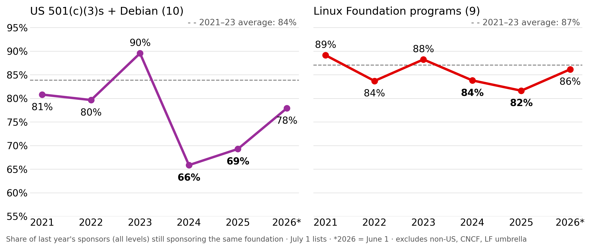

.bottomnote[Standalone c3s lost sponsors in 2024-25; LF programs barely dipped]

???
Retention = of the sponsors listed on July 1 last year, what share is still listed at the same foundation this July 1.
Left: Apache, Debian (via SPI), FreeBSD, Gentoo, Haskell, LLVM, NumFOCUS, OSGeo, Python SF, Software Freedom Conservancy. Right: ASWF, CD Foundation, FINOS, GraphQL, Hyperledger, LF AI & Data, LF Energy, Open Mainframe, OpenSSF.
US c3s: 90% (2023) to 66% (2024) and 69% (2025), recovering to 78% so far in 2026. Python SF's list is volatile; without it the c3 dip is still 90% to 75%.
LF programs: 82-89% every year. CNCF alone fell to 73% in 2024, so this is not entirely "LF is immune".
Excluded: non-US foundations, CNCF and the LF umbrella list (they mix members and landscape entries), OpenStack and Eclipse (page scope changes), OWASP (list reset in Nov 2023).
Question for the audience: why would the same companies cut standalone charities first?

---
template: logorb
name: short
# Sponsorships Are Short

Top three cash levels only, 10 US c3s + 9 LF programs:

- **347** top-tier sponsors left; median stay **1.4 years**
- **62%** left within 2 years
- Current top-tier sponsors: **2.7 years** so far
- Apache: **24** left, median stay **2.4 years**
- Only **8** of 347 stepped down a level; the rest left entirely

> Renewals matter as much as new logos

.bottomnote[First, second and third cash levels; excludes in-kind, community and lower tiers]

???
US c3s plus Debian: 89 top-tier sponsors left, median 1.8 years. LF programs: 258 left, median 1.4 years (there, "third" is usually the broad general-membership tier).
Sponsors already present when tracking began are left out of these medians, because we don't know when they started.
Comparison from general US fundraising (Fundraising Effectiveness Project 2023 data): donors giving under $100 renew at about 31%; major donors at about 66-68%. FOSS corporate sponsors renew at higher rates than that most years, but the ones who leave go quickly.

---
template: logorb
name: umbrella
# Umbrella vs Standalone

Sponsors listed, July 2023 to June 2026:

.left-column-equal[
**Umbrella**
- Linux Foundation: **1,580 to 2,112**
- LF programs retention: **82-89%** a year
]
.right-column-equal[
**Standalone c3s**
- Apache: **78 to 55**
- Python SF: **79 to 71**
- NumFOCUS: **28 to 19**
]

> Is corporate money consolidating into umbrella foundations?

???
The LF list counts members (many companies join the LF at Silver to join a sub-foundation), so it is not directly comparable to a c3 sponsor list - but the direction is clear.
Possible reasons to discuss: membership in a c6 trade association reads as a business expense with governance seats; c3 sponsorship reads as charity and gets cut first in a budget squeeze.
Research tie-in: Izquierdo and Cabot (2018) describe foundations as different kinds of legal and organizational shells; this is one place the difference shows up in money.
---
template: logorb
# Nonprofit Types (US focus)

.left-column-equal[
**501(c)(3)**
- Charitable Organization
- Tax-deductible for donors
- Restrictions on activities
- *Files IRS form **990** yearly*
]
.right-column-equal[
**501(c)(6)**
- Business League
- Not tax-deductible
- For "common business interest"
- *Files IRS form **990** yearly*
]

.bottomnote[How do we map EU charities to this?]

???

- [IRS 501(c)(3) definition](https://www.irs.gov/charities-non-profits/charitable-organizations/exemption-requirements-501c3-organizations): Charitable organizations
- [IRS 501(c)(6) definition](https://www.irs.gov/charities-non-profits/other-non-profits/requirements-for-exemption-business-league): Business leagues

---
template: logorb
# Foundation Finances 990s

US IRS 990 tax forms capture:

- Revenue: contributions, dues, program services
- Expenses: *program* vs *management* vs *fundraising*
- Net assets, cash, deferred revenue
- Employees, volunteers, board
- Officer pay; top contractors
- Grants given; related organizations

.bottomnote[NEW: IRS e-file XML through FY2025 via github.com/Punderthings/foss990parser]

???

With apologies for the US focus here - I haven't had time to figure out how to get EU finance data at scale.  In the US, with many thanks to the [Nonprofit Explorer by ProPublica](https://projects.propublica.org/nonprofits/api).
NEW this year: ProPublica lags 1-2 years and only extracts ~70 summary fields. FOSS990Parser reads the IRS's own e-file XML directly (GivingTuesday data lake + IRS monthly zips): 398 filings for 65 foundations, 94 of them not yet in ProPublica, including fiscal year 2025.
CAUTION: FY2025 data is partial. Calendar-year foundations file their 2025 990s from May to November 2026 (with extensions), so most FY2025 numbers in this talk come from early filers and non-calendar fiscal years like the ASF (April) and Conservancy (February). Trends use FY2024 as the last complete year.

---
template: logorb
# Finance Data - 501(c)(3)

.left-column-equal-vsm[
- **Electronic Frontier Foundation**
- **Signal Technology Foundation**
- Creative Commons Corporation
- Numfocus Inc
- The Freebsd Foundation
- Software Freedom Conservancy Inc
- Opencollective Foundation
- Python Software Foundation
- Beneficent Technology Inc
- Apache Software Foundation
- Plone Foundation
- Software In The Public Interest Inc
- Kuali Foundation Inc
- Open Source Robotics Foundation Inc
- Open Education Global Incorporated
- Free Software Foundation Inc
- Drupalcon Inc
- United States Postgresql Association
- **Wikimedia Foundation**
- **Mozilla Foundation**
- Open Technology Fund
]
.right-column-equal-vsm[
- Internet Systems Consortium Inc
- Gnome Foundation Inc
- Open Information Security Foundation Inc
- Llvm Foundation
- Wordpress Foundation
- Participatory Culture Foundation
- Open Molecular Software Foundation
- Open Source Election Technology Institute
- Ruby Central Inc
- Linux Expo Of Southern California
- Yet Another Society
- Open Source Initiative
- Haskell Org Inc
- Biobricks Foundation Incorporated
- Netbsd Foundation
- Django Events Foundation North America
- Tex Users Group
- Software Freedom Law Center Inc
- Sahana Software Foundation
- Raspberry Pi Foundation North America Inc
]

---
template: logorb
# Finance Data - 501(c)(6)

.left-column-equal[
- **Linux Foundation**
- AlmaLinux OS Foundation
- Bytecode Alliance
- Clojurists Together
- Commonhaus Foundation
- .Net Foundation
- OASIS Open
]
.right-column-equal[
- Open Compute Project
- Open Connectivity Foundation
- Open Source Collective
- OpenID Foundation
- OpenInfra (OpenStack) Foundation
- Rails Foundation
- **Rust Foundation**
]

???
Recall that the Linux Foundation is the parent to two or three hundred foundations, like the CNCF, in case you're thinking something's missing here.  They are directed funds inside the LF's single 990, so they have no separate tax filings.
Note: OSGeo and OpenJS file as 501(c)(4) organizations.

---
template: fullheader
# Foundation Finances

Let's explore some 501(c)(3) finances!

---
template: logorb
# C3 - Revenues

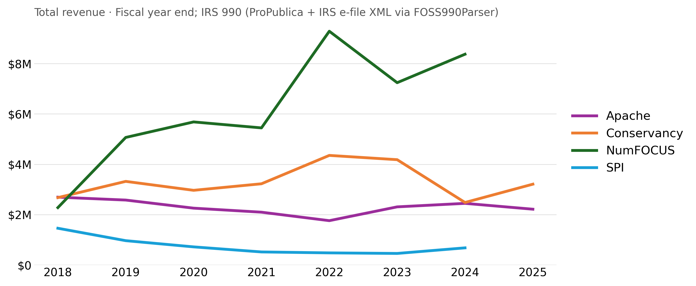

???
Here are the total revenues for 4 comparable US c3 foundations that host multiple projects.
Years are fiscal year end (ASF's year ends April 30, SFC's in February). 2025 points are shown where the 990 has been filed; most calendar-year foundations file 2025 returns in late 2026.

---
template: logorb
# C3 - Net Assets

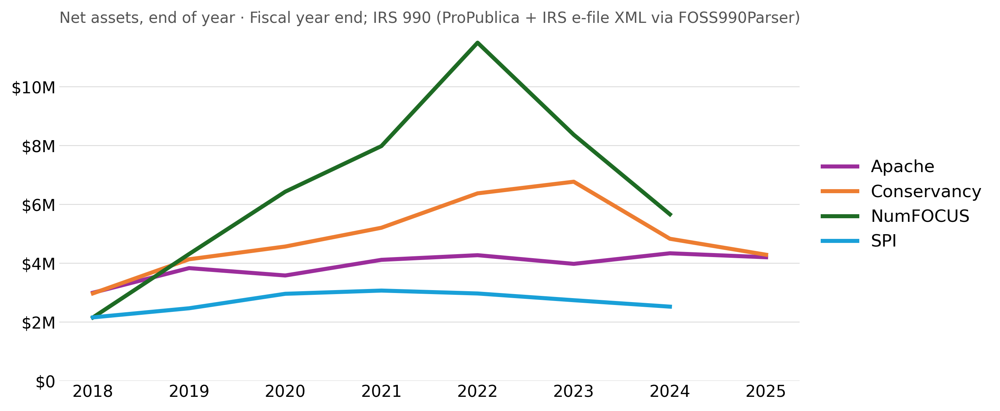

???
Now we're looking at the net assets at end of year for those four foundations.

---
template: logorb
# C3 - Revenues - Outliers

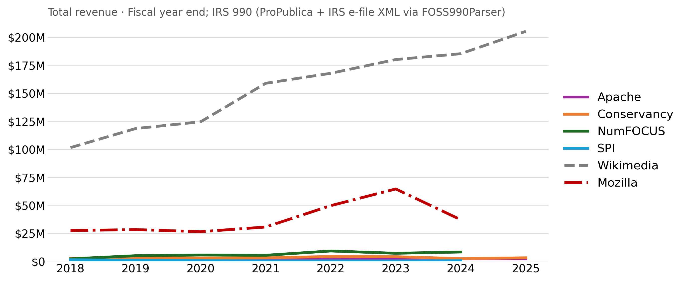

???
Here are the same four foundations, plus the related-but-not-quite C3 foundations Wikimedia and Mozilla.  Note that Signal Foundation and the EFF are both also highly endowed.

---
template: logorb
# C3 - Net Assets - Outliers

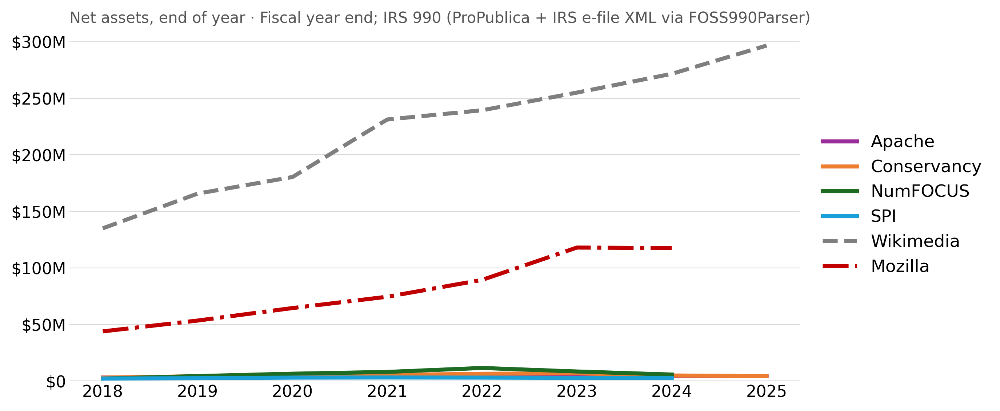

???
Here are the same four foundations, plus the related-but-not-quite C3 foundations Wikimedia and Mozilla.  Note that Signal Foundation and the EFF are both also highly endowed.

---
template: logorb
# C3 - Annual Average Finances

.left-column-equal[
**Average Revenues**
- All 44 tracked c3 orgs: 
  - 9.2M USD
- **Not** including Mozilla, Wikimedia, EFF, Signal:
  - 3.1M USD
]
.right-column-equal[
**Average Net Assets**
- All 44 tracked c3 orgs:
  - 11.5M USD
- **Not** including Mozilla, Wikimedia, EFF, Signal:
  - 1.65M USD
]

.bottomnote[Fiscal year 2024 990s; fossfoundation.info + FOSS990Parser]

???
Fiscal year 2024 (the latest year nearly all foundations have filed). Last year's deck showed FY2023: 2.6M average revenue and 1.9M average net assets for the smaller c3s.
Revenue is up a little, but net assets are down - next slide.

---
template: logorb
# Spending More Than They Raise

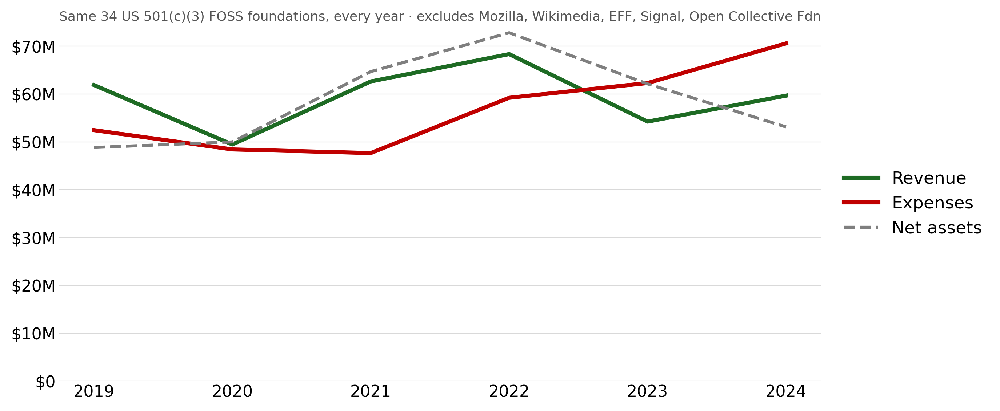

.bottomnote[FY2024: **22 of 39** c3 foundations spent more than they took in]

???
This is the same set of 34 US 501(c)(3) FOSS foundations that filed every year 2019-2024, excluding the big four outliers and the Open Collective Foundation (which wound down in 2024, spending down ~$19M of net assets).
Since FY2023, expenses have run ahead of revenue. Across 39 c3s (excluding OCF), net assets fell from 76M to 65M USD, about -14%, in one year.
Examples: NumFOCUS 8.4M to 5.7M, Conservancy 6.8M to 4.8M, PSF 4.7M to 3.4M, FreeBSD 4.9M to 4.0M.
Question for the audience: is this planned spend-down of pandemic-era reserves, or a funding gap?

---
template: fullheader
# Foundation Finances

Let's explore some 501(c)(6) finances!

---
template: logorb
# C6 - Revenues

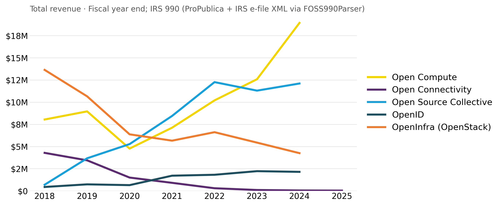

???
Here are the majority of US C6 foundation revenues.

---
template: logorb
# C6 - Net Assets

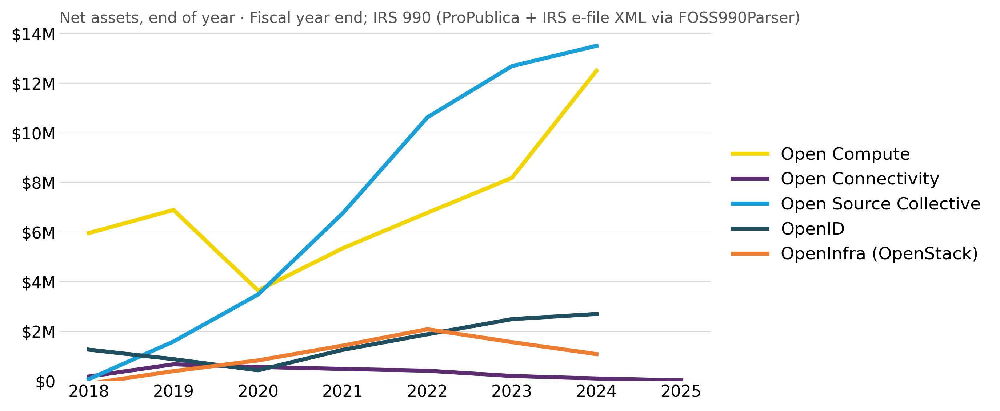

???
Here are the majority of US C6 foundation net assets.

---
template: logorb
# C6 - Revenues - Oh, Wait

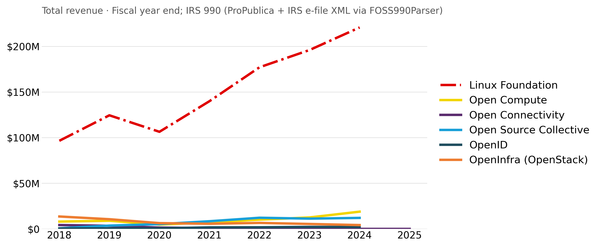

???
Oh, I apologize, I forgot to include the Linux Foundation!

---
template: logorb
# C6 - Net Assets - Oh, Wait

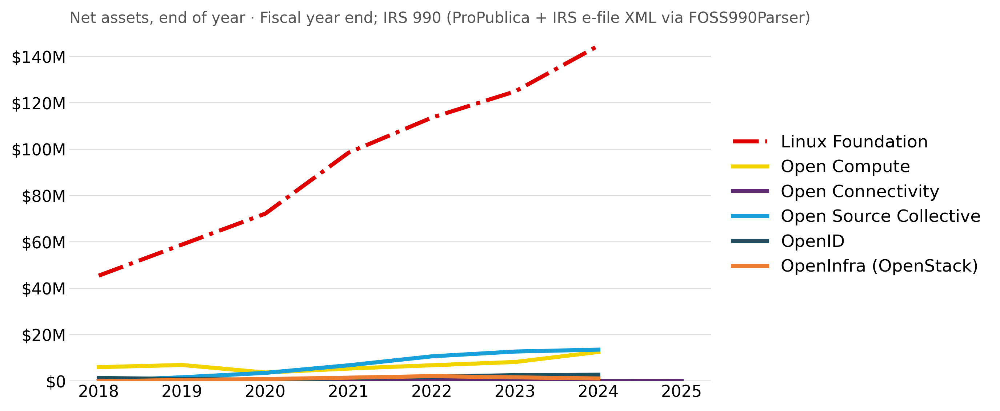

---
template: fullheader
# Foundation Finances

Let's compare c3s versus c6's!

---
template: logorb
# Foundation Net Asset Sums

Total **net assets** of 40 c3 foundations
  *(excluding Wikimedia, Mozilla, EFF, Signal)*

## **66M USD**

Net assets of the Linux Foundation in 2024:

## **145M USD**

.bottomnote[https://github.com/Punderthings/fossfoundation/blob/main/_data/p990/foundations_990_common.csv]

???
Figures are rounded, from US 990 forms for fiscal year 2024. (Last year's slide compared total assets: the LF's total assets are now 224M USD.)
The c3 total includes the Open Collective Foundation's wind-down; even excluding it, the smaller c3s lost about 14% of net assets in one year, while the LF grew about 16%.

---
template: fullheader
name: spending
# Where Does the Money Go?

???
New this year: the full IRS e-file data lets us look past top-line revenue - into how foundations earn, spend, and save.

---
template: logorb
# Contributions, per the IRS

.left-column-equal[
**Linux Foundation, 2024**
- Total revenue: **221M**
- "Contributions": **6.6M**
- Project & event fees: **149M**
- Training: **29M**
- Membership dues: **20M**
]
.right-column-equal[
**Other c6 examples**
- OpenInfra: dues **4.2M** booked as *contributions*
- Open Compute: conferences **14M** of 19M
- Rust Foundation: dues **2.1M** of 5.3M
]

.bottomnote[IRS 990 Part VIII line 2: program service revenue by type]

???
"Contributions" on a 990 means what IRS tax law says it means (Part VIII line 1: gifts, grants, membership dues treated as gifts), not the everyday sense of "all the money people give us". Program service revenue (line 2) is money earned by doing the mission: https://www.irs.gov/instructions/i990#en_US_2025_publink11283jd0e10859
c6 trade associations book most corporate money as "program service revenue", not contributions - and they don't all book it the same way.
So comparing "contributions" across c3s and c6s is apples to oranges. The detail lines in the e-file data fix that.

---
template: logorb
# How Foundations Spend

| Foundation | Expenses | Program | Staff | Volunteers |
|---|---|---|---|---|
| **Apache** (FY Apr 2025) | 2.3M | 87% | 4 | 8,200 |
| NumFOCUS (2024) | 11.1M | 94% | 25 | 383 |
| Conservancy (FY Feb 2025) | 3.8M | 78% | 8 | 5,000 |
| Python SF (2024) | 5.8M | 86% | 14 | 1,200 |
| FreeBSD (2024) | 2.6M | 81% | 6 | 5 |
| OSI (2024) | 1.0M | 65% | 1 | 20 |

.bottomnote[IRS 990 Part IX functional expenses; Part I staff and volunteer counts as reported]

???
Program percentage = program services share of total functional expenses (vs management and fundraising).
IRS definition of the program services column (Form 990 Part IX, column B): https://www.irs.gov/instructions/i990#en_US_2025_publink11283jd0e12386 (2025 instructions; the anchor changes with each year's edition).
501(c)(6)s like the LF and Rust aren't required to split expenses this way, so they're not shown.
Volunteer counts are self-reported estimates - but 8,200 for the ASF tells its own story.

---
template: logorb
# Apache: Volunteers + Contractors

.left-column-equal[
**FY ending April 2025**
- Revenue: **2.22M**
- Expenses: **2.33M**
- Net assets: **4.21M** *(~1.8 years)*
- Deferred revenue: **1.23M**
]
.right-column-equal[
**Who gets paid?**
- Officers & directors: **$0**
- Salaries: **$0** (since FY2021)
- Contractors over 100K: **3**
  - System administration
  - Services
  - Publicity
]

.bottomnote[ASF 990 for FY2025 (TY2024), IRS e-file]

???
The ASF reports 4 employees but no salary expense: staff work is paid through contractors (990 Part VII-B), and every officer and board member is unpaid.
Deferred revenue of 1.2M is mostly sponsorship paid in advance.
A small operating deficit this year, against healthy reserves of about 1.8 years of expenses.

---
template: logorb
# Years of Runway

.left-column-equal[
**Net assets ÷ annual expenses**
- GNOME: **3.2** <i>$3.2M</i>
- SPI: **2.7** <i>$2.6M</i>
- Apache: **1.8** <i>$5.5M</i>
- FreeBSD: **1.6** <i>$4.1M</i>
- Conservancy: **1.1** <i>$5.4M</i>
]
.right-column-equal[
&nbsp;
- OSI: **0.8** <i>$1.0M</i>
- Linux Foundation: **0.7** <i>$224M</i>
- Python SF: **0.6** <i>$4.3M</i>
- NumFOCUS: **0.5** <i>$6.4M</i>
- OpenInfra: **0.2** <i>$1.4M</i>
]

.bottomnote[Latest filed 990 per foundation (FY2024 or FY2025); *small italics: total assets*]

???
A rough resilience measure; years = NET assets / expenses, while the small italic figure is TOTAL assets (before liabilities). CAUTION: mixes FY2024 and FY2025 filings, depending on what each foundation has filed so far; FY2025 is partial. Note that net assets include restricted funds - for fiscal sponsors like NumFOCUS and Conservancy, much of that money belongs to specific projects.

---
template: logorb
# Who Pays Maintainers?

- **60%** of maintainers are unpaid *(Tidelift 2024)*
- Of paid maintainers, only **3%** are paid by foundations
- **25,885** GitHub projects ask for donations, but no clear evidence donations raise project activity *(Overney et al., ICSE 2020)*
- Schedule I grants by FOSS foundations are small:
  - Python SF: **0.38M** (2024); Rust: **0.16M** (2025)
  - Big grantmakers: Wikimedia, Mozilla, LF Charities

> Foundations mostly fund the *platform*, not the *people*

???
Overney, Meinicke, Kästner, Vasilescu: "How to Not Get Rich: An Empirical Study of Donations in Open Source", ICSE 2020. Donations are often requested for engineering work, but are used in many different ways.
Fiscal sponsors (NumFOCUS, Conservancy, SPI) spend on behalf of their projects as program expenses, which is different from grants.
Top contractor lists show where foundation money does reach individual engineers and sysadmins.

---
template: logorb
name: renew
# Ask Your Employer to Renew

- Does your employer sponsor the foundations you rely on?
- At what level, and **since when**?
- Renewing, or holding a level, is worth more than a new logo
- Look up any foundation's sponsor history:

.code[https://fossfoundation.info/sponsorships]

.bottomnote[Apache: https://www.apache.org/foundation/sponsorship.html]

???
Call to action built on the squeeze and the short tenure numbers: most sponsors who leave do so within two years, and few step down a level - they just stop.
If you are inside a sponsoring company, the most useful thing may be making sure the renewal happens.
---
template: thanks
name: closingslide
class: inverse-header
# Foundations Data

FOSS Foundations metadata and models

.code[https://fossfoundation.info/]

Do your own US funding research

.code[https://projects.propublica.org/nonprofits/]

.code[https://github.com/Punderthings/foss990parser]

Open Source Sustainability research

.code[https://fosssustainability.com/]

---
name: last-page
template: thanks

## Thank You &amp; Questions!

## [@shanecurcuru@fosstodon.org](https://fosstodon.org/@shanecurcuru)
.code[https://shaneslides.com]

<a rel="license" class="code" href="https://www.apache.org/licenses/LICENSE-2.0.html">Apache v2.0</a>

---
template: logorb
# Other topics to investigate

- [Open Source Endowment](https://endowment.dev/) - launched Feb 2026; grants only investment returns
- Public funders: [Sovereign Tech Agency](https://www.sovereign.tech/) (DE), [Open Technology Fund](https://www.opentech.fund/) (US; 2025 grant termination in court)
- Open Source Sustainability
  - [Aspects of sustainability](https://fosssustainability.com/aspects/)
  - [FOSS Sustainability Zotero library](https://www.zotero.org/groups/5030713/foss-sustainability/library)
  - [Defining FOSS Project Health](https://fosssustainability.com/health)
- [Reviewing funding models](https://fossfunding.com/#how-are-individual-projects-or-maintainers-funded)
  - Patreon and crowdfunding
  - Bountysource pays for specific work
  - Tidelift, Liberapay, Open Collective and subscriptions
  - Building your own business model
  - [Open Source Pledge](https://opensourcepledge.com/): pay $2K/engineer to maintainers
- RedisLabs and the Commons Clause
  - Source-Available or Cloud Licenses or [Software Commons](https://openpath.chadwhitacre.com/2024/towards-software-commons/)
  - [Fair Source movement](https://fair.io/licenses/) to codify BSL-like licenses
  - "Commercial" Open Source - does that really help?

???
There's a lot more to talk about out there - I look forward to your ideas!

---
template: logorb
# Open Source is a ________________

- Sustainable contribution model.
- Model for broad innovation.
- **NOT** a [Business model](https://medium.com/@stephenrwalli/there-is-still-no-open-source-business-model-8748738faa43).

## What does "Open Source Sustainability" mean to you?

???
Yes, this is a trick question.
https://medium.com/@stephenrwalli/there-is-still-no-open-source-business-model-8748738faa43

---
template: logorb
name: appendix-lf-members
# Linux Foundation Member Changes

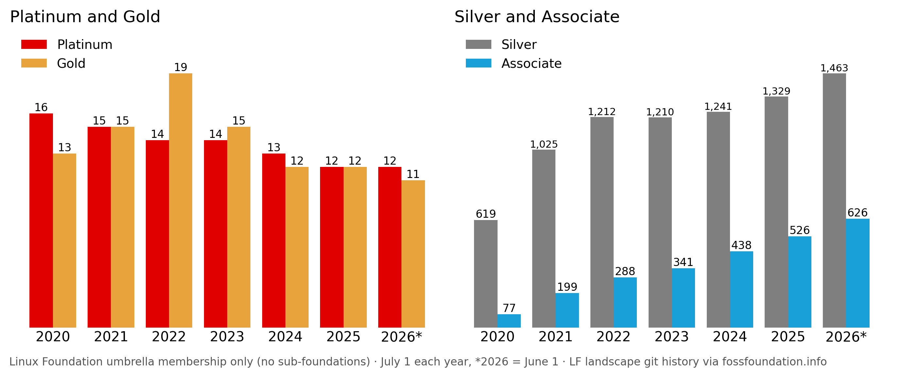

.bottomnote[Appendix · LF umbrella only: Platinum 16 to 12, Gold 19 to 11, Silver 619 to 1,463]

???
LF umbrella membership only, not sub-foundations (CNCF, OpenSSF and others have their own lists).
Counts are members listed on July 1 each year (2026 = June 1), from 80 versions of the LF landscape file in git, Dec 2019 to Oct 2026.
Platinum: 16 (2020) to 12 (2026). Gold peaked at 19 in 2022 and is now 11. Silver more than doubled (619 to 1,463) and Associate grew eightfold (77 to 626).
Many companies join the LF at Silver because a sub-foundation membership requires it, so Silver growth tracks the growth of LF projects as much as interest in the LF itself.
Latest (Oct 7 2026): 13 Platinum, 11 Gold, 1,686 Silver, 717 Associate.
